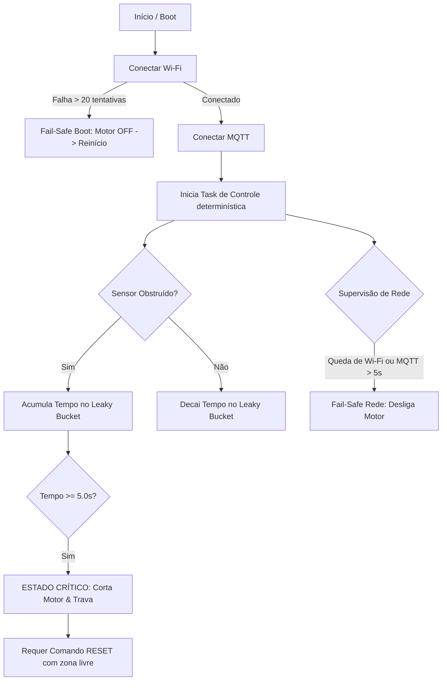

# Sistema Receptor de Intertravamento e Segurança Industrial (ESP32 - ESP-IDF)

> **Projeto de Conclusão de Curso (TCC)**  
> Sistema embarcado distribuído para supervisão perimetral, segurança de máquinas e intertravamento eletromecânico com telemetria em tempo real via MQTT sobre FreeRTOS.

---

## 📌 Visão Geral

Este projeto consiste no firmware do **Nó Receptor/Controlador de Segurança**, desenvolvido sobre o microcontrolador **ESP32** utilizando o framework nativo **ESP-IDF v5.x** e **C++**. 

O sistema implementa uma malha de segurança com **intertravamento (*latching*)** baseada em barreira infravermelha (IR) e controle de corte de atuador (motor/relé), além de monitoramento e controle remoto via protocolo **MQTT**.

### Principais Características
- **Segurança Fail-Safe Ativa:** O motor é desligado compulsoriamente em caso de intrusão prolongada, perda de conectividade com a rede por mais de 5 segundos ou falha no boot.
- **Algoritmo de Tolerância Acumulada (*Leaky Bucket*):** Filtra falsos positivos de passagem rápida e acumula o tempo de obstrução perimetral até o limite crítico pré-configurado (ex: 5 segundos).
- **Provedor de Tópicos Dinâmicos por Hardware (Zero-Touch Provisioning):** Os tópicos MQTT são gerados em tempo de execução a partir do endereço MAC de fábrica do ESP32 (`irbar_<MAC_FINAL>/...`), permitindo gravar o mesmo binário em frotas de múltiplos equipamentos sem colisão de rede.
- **Arquitetura Concorrente no FreeRTOS:** Desacoplamento estrito entre a malha de segurança física determinística e a pilha de conectividade Wi-Fi/MQTT através de filas (*Queues*) e *Mutexes*.
- **Last Will and Testament (LWT):** Notificação em tempo real pelo broker em caso de queda abrupta de energia ou falha de sinal do dispositivo.

---

## 🏗️ Arquitetura do Software

O firmware segue uma arquitetura orientada a objetos com forte separação de responsabilidades e padrões de projeto consolidados:

```
receptor-esp32-espidf-ccp-tcc-final/
├── CMakeLists.txt              # Configuração raiz do projeto ESP-IDF
├── sdkconfig                   # Configurações do SDK (FreeRTOS, Wi-Fi, etc.)
└── main/
    ├── CMakeLists.txt          # Registro do componente e fontes C/C++
    ├── main.cpp                # Supervisor de rede, Fail-Safe e orquestrador
    ├── hardware/               # Camada de Abstração de Hardware (HAL)
    │   ├── IrBarrierSensor.h   # Driver do sensor óptico de barreira (TSOP)
    │   ├── IrBarrierSensor.cpp
    │   ├── Motor.h             # Driver do atuador/relé do motor
    │   └── Motor.cpp
    ├── logic/                  # Regras de Negócio e Segurança Física
    │   ├── ProcessController.h # Máquina de estados, Leaky Bucket e Task FreeRTOS
    │   └── ProcessController.cpp
    ├── manager/                # Camada de Conectividade e Protocolos
    │   ├── WiFiManager.h       # Singleton de conexão e reconexão Wi-Fi
    │   ├── WiFiManager.cpp
    │   ├── MqttManager.h       # Singleton cliente MQTT, filas e tópicos dinâmicos
    │   └── MqttManager.cpp
    └── include/                # Definições Globais e Credenciais
        ├── mqtt_topics.h       # Dicionário de comandos e sufixos MQTT
        ├── secrets_example.h   # Template para credenciais de rede
        └── secrets.h           # Credenciais locais (ignorado no Git)
```

### Padrões de Projeto Utilizados
- **Singleton Pattern:** Aplicado em `WiFiManager` e `MqttManager` para garantir ponto único de acesso ao rádio e broker, prevenindo vazamentos de sockets e concorrência indevida.
- **Dependency Injection (DI):** O `ProcessController` recebe instâncias abstratas de `Motor` e `IrBarrierSensor`, facilitando a testabilidade e isolando as decisões lógicas dos pinos físicos.
- **FreeRTOS Class Wrapper:** Encapsulamento de tarefas C++ em funções estáticas com injeção do ponteiro `this`, permitindo tasks orientadas a objeto.

---

## ⚙️ Mapeamento de Pinos (GPIO)

| Periférico | Pino ESP32 | Função / Modo | Descrição |
| :--- | :--- | :--- | :--- |
| **Sensor de Barreira IR** | `GPIO 4` | Entrada Digital (`INPUT`) | Sensor óptico receptor (ex: TSOP). Nível 1 = Obstruído. |
| **Atuador Principal** | `GPIO 18` | Saída Digital (`OUTPUT`) | Controle do relé/chave de potência do motor. |

---

## 📡 Protocolo e Tópicos MQTT

### Geração Automática do Prefixo
Na inicialização, o `MqttManager` lê os 3 últimos bytes do MAC físico do Wi-Fi STA:
$$\text{Prefixo} = \text{irbar\_} + \text{MAC}[3..5]$$
*Exemplo de prefixo gerado:* `irbar_457734`

### Tópicos Utilizados

| Tópico Completo (Exemplo) | Direção | QoS | Retain | Descrição |
| :--- | :---: | :---: | :---: | :--- |
| `irbar_457734/tx/status` | ESP32 ➔ Broker | 1 | Sim | Status de conexão (`on`/`off` via LWT) e rearme (`RESET_APPLIED`). |
| `irbar_457734/tx/telemetry` | ESP32 ➔ Broker | 0 | Não | Telemetria contínua com estado do sensor e acumulador de tempo. |
| `irbar_457734/tx/alarm` | ESP32 ➔ Broker | 1 | Não | Disparado imediatamente quando o intertravamento crítico é acionado. |
| `irbar_457734/rx/command` | Broker ➔ ESP32 | 1 | - | Canal de recepção de ordens do operador / supervisório. |

### Dicionário de Comandos JSON (Recepção)
As mensagens enviadas para `.../rx/command` devem seguir a estrutura JSON:
```json
{
  "command": "<ACAO>"
}
```

Valores aceitos para `<ACAO>`:
- `"reset"`: Rearma o sistema após intertravamento (só aceito se a barreira estiver desobstruída).
- `"turn_on"`: Acionamento manual do motor (se não houver bloqueio de segurança).
- `"turn_off"`: Desligamento manual do motor.
- `"block"`: Bloqueio administrativo remoto (impede o acionamento mesmo com zona livre).
- `"unblock"`: Libera o bloqueio administrativo.

### Payload de Telemetria (Transmissão)
Publicado periodicamente em `.../tx/telemetry`:
```json
{
  "is_obstructed": false,
  "bucket_time": 0.00,
  "system_status": "NORMAL",
  "is_motor_on": true,
  "is_backend_blocked": false
}
```

---

## 🛡️ Mecanismos de Fail-Safe e Segurança



1. **Intertravamento (*Latching*):** Ao violar a barreira por mais tempo do que a tolerância parametrizada, o motor desliga instantaneamente e o sistema entra em estado de alarme crítico. Mesmo que a barreira seja desimpedida, o motor **não volta a girar sozinho**, exigindo intervenção deliberada via comando de `"reset"`.
2. **Watchdog de Rede:** Se a comunicação sem fio cair por mais de **5000 ms**, o motor é desligado preventivamente para evitar operação em condição não supervisionada.
3. **Isolamento de Memória (Heap Protection):** As mensagens recebidas passam por deserialização protegida com buffer fixo para mitigar riscos de *Buffer Overflow*, convertendo strings em comandos numéricos antes de entrar na fila do FreeRTOS.

---

## 🚀 Como Compilar e Gravar

### Pré-requisitos
- **ESP-IDF v5.x** instalado e configurado no ambiente de desenvolvimento.
- Placa de desenvolvimento com chip ESP32 (ex: ESP32 DevKit v1).
- Cabo USB de dados.

### 1. Configurar Credenciais
Copie o modelo de credenciais e preencha com os dados da sua rede e do broker MQTT:
```bash
cp main/include/secrets_example.h main/include/secrets.h
```
Abra o arquivo `main/include/secrets.h` e edite:
```c
#define SECRET_WIFI_SSID "Sua_Rede_WiFi"
#define SECRET_WIFI_PASS "Sua_Senha_WiFi"

#define SECRET_MQTT_URI  "mqtt://192.168.1.100:1883"
#define SECRET_MQTT_USER "usuario_mqtt"
#define SECRET_MQTT_PASS "senha_mqtt"
```

### 2. Compilação e Gravação
No terminal do projeto (com as variáveis de ambiente do ESP-IDF carregadas):

```bash
# Configurar target para ESP32 padrão (se necessário)
idf.py set-target esp32

# Compilar o projeto
idf.py build

# Gravar no microcontrolador e abrir o monitor serial
idf.py -p /dev/ttyUSB0 flash monitor
```
*(Substitua `/dev/ttyUSB0` pela porta serial correspondente ao seu sistema operacional).*

---

## 🧪 Diagnóstico e Monitoramento

Ao inicializar, a saída do console serial exibirá o processo de inicialização e o prefixo dinâmico gerado:
```text
I (1020) WiFiManager: Wi-Fi Connected to AP!
I (1540) MqttManager: Dynamic MQTT prefix generated: irbar_457734
I (2100) MqttManager: MQTT Connected!
I (2110) MqttManager: Subscribed to irbar_457734/rx/command
```

---

## 👥 Autor & Agradecimentos

- **Projeto:** Trabalho de Conclusão de Curso (TCC) em Engenharia.
- **Foco:** Sistemas Críticos Embarcados, Segurança Funcional e IoT Industrial.
